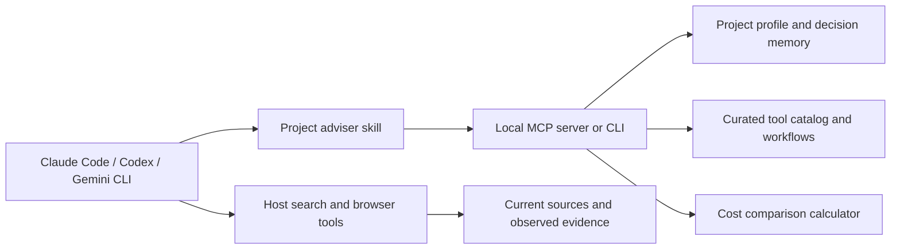

# Stepwise Architect

A free, open-source project adviser for indie builders working in **Claude Code, Codex and Gemini CLI**. Choose tools for the step you are doing now, keep project decisions, and compare total costs before adding another subscription.

**0.1.0 is an experimental local alpha.** It provides a curated tool shortlist, workflows, project memory and a cost calculator through a CLI and eight MCP tools. Your coding assistant supplies reasoning, code inspection and live research. The core does not call a model or require another model API key.

## Try it in two minutes

Requires Node.js 22 or newer and npm. Download this repository or clone it, then open its directory:

```sh
npm ci --ignore-scripts
npm run demo
npm test
```

The demo recommends a review workflow for an indie SaaS. To compare hypothetical costs:

```sh
node bin/stepwise.mjs compare-costs --file examples/costs.json
```

The example produces **160 current, 115 proposed, 45 estimated monthly saving in USD**, with 60 switching cost and about 1.33 months payback. These are invented demonstration inputs, not vendor prices or verified savings.

## Use it on your product

Create a project profile from `examples/seo-project.json`, change the fields to your actual project, then use an explicit existing project path:

```sh
node bin/stepwise.mjs init --project /absolute/path/to/product --file examples/seo-project.json
node bin/stepwise.mjs advise --project /absolute/path/to/product --stage review --task "Review code within my budget"
node bin/stepwise.mjs research --project /absolute/path/to/product --task "Validate demand for my SEO reporting product"
node bin/stepwise.mjs remember --project /absolute/path/to/product --file examples/decision.json
node bin/stepwise.mjs recipe --project /absolute/path/to/product --file examples/recipe.json
```

Project paths above are inputs: replace them with your actual folder. Only `init`, `remember` and `recipe` write state. Add `.stepwise/` to that product's `.gitignore` before using real project details. The core writes local plain JSON; do not store secrets or customer records there.

## What it helps with

| Current step | Adviser output |
| --- | --- |
| Market research and validation | Queries, evidence fields, competitor comparison method and interview experiment |
| Planning and architecture | A bounded next step, constraints, alternatives and decision criteria |
| Generic-looking UI | A workflow to inspect actual pages, improve design and verify results |
| Coding and review | Existing assistant and suitable checks compared with paid alternatives |
| Agents and AI quality | Bounded workflow, retries, evaluation and total usage cost |
| Database and hosting | Requirement checks, managed versus self-hosted trade-offs |
| Automation and marketing | Small experiments, repeated jobs and measurable activation |
| Ongoing operations | Revisit saved decisions when workload, needs or official tools change |

There are **20 curated tool candidates and 15 stage workflows**. They are starting points, not universal rankings. Recommendations use task tags, existing tools and explicit constraints. The assistant must verify project-specific fit, current capabilities and prices.

## Install in your assistant

See [the installation guide](docs/INSTALL.md) for Claude Code plugins, the Codex marketplace, Gemini CLI extensions, and direct MCP fallback. Run `npm ci --ignore-scripts` in the installed copy before starting its server. Package managers differ in whether they install dependencies automatically; do not assume they do.

Claude Code users can add this source with `/plugin install stepwise-architect --marketplace SoumaCloud/stepwise-architect`. For this alpha, the prepared local-clone route in the installation guide makes dependency setup easier to verify.

Ask your assistant:

> Use project-adviser for my current product. Read its saved context. Help me choose a lower-cost review workflow, explain the trade-offs, verify current official sources, and prepare one small experiment. Save the decision after I accept it.

## Architecture



## Honest limits

- Market research is a **plan** until the host assistant actually searches and collects sources. Reddit, X and other sites may restrict access.
- The catalog is manually curated and date-stamped. There is no automatic daily feed or live price scraper.
- Local-only, sensitive-data and subscription constraints filter known conflicts. Unknown metadata remains a verification requirement. This is not a security audit or regulatory certification.
- The cost engine uses your rates and quantities in one currency for the same workload. It cannot validate the truth of those inputs. Existing subscriptions, model calls and external services can still cost money.
- No automatic tool installation, external posting, purchases, telemetry or source-code scanning. The host may share MCP results with its model provider under its own settings.
- No live architecture dashboard yet. A browsable decision graph and measured outcome tracking are later milestones.
- Client manifests are provided for all three platforms; see [validation status](docs/VALIDATION.md) for what was actually run. Public directory approval is separate from publishing this repo.

## Contribute and test

MIT licensed, with no signup required for the local core. Try one real workflow, then open a GitHub issue with your stage, constraints, existing tools, useful or unsuitable recommendation, source URLs and measured outcome. Remove confidential details. Stars help discovery; repeat use and better project outcomes are the product test.

See [the day-wise plan](docs/ROADMAP.md), [contribution guide](CONTRIBUTING.md) and [security notes](SECURITY.md).
